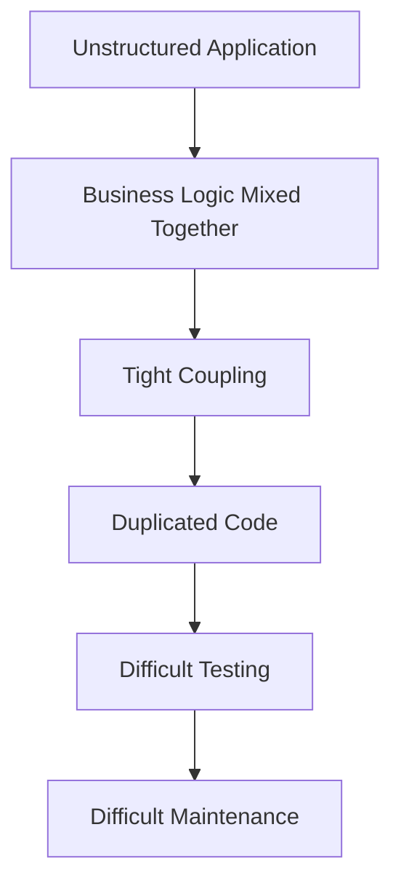
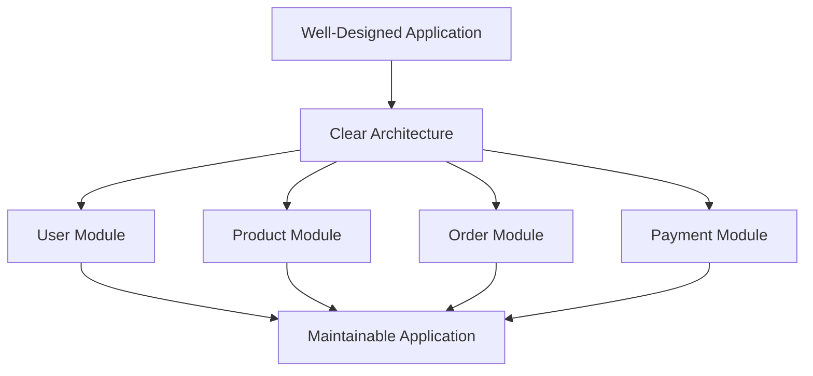
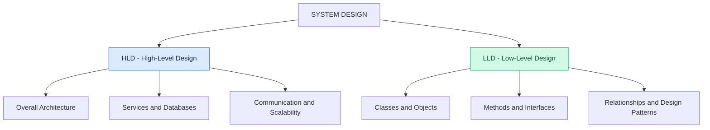
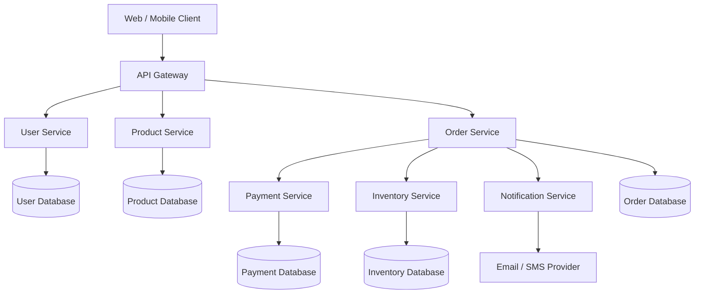
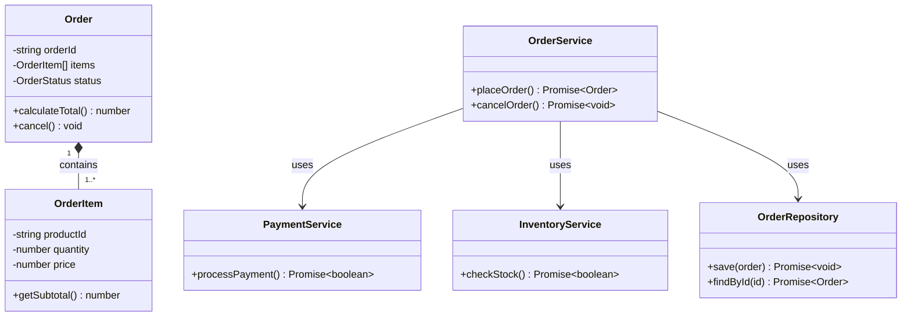
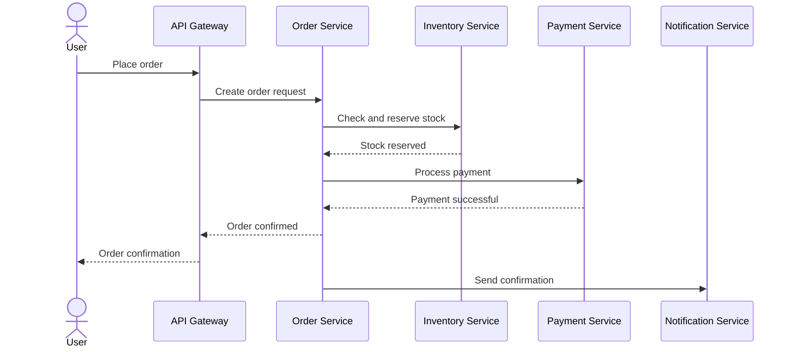
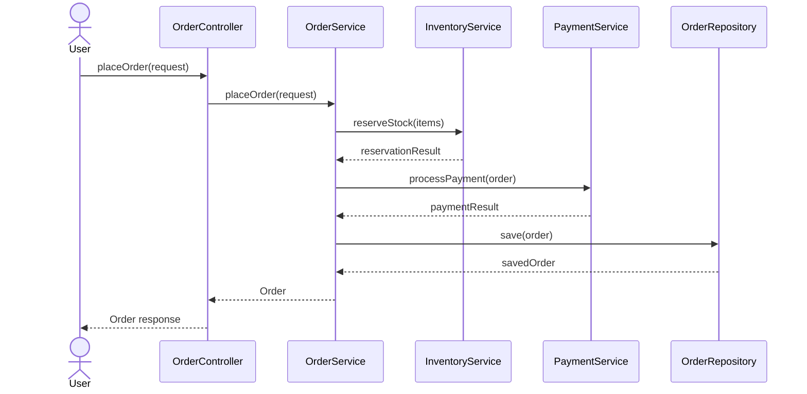
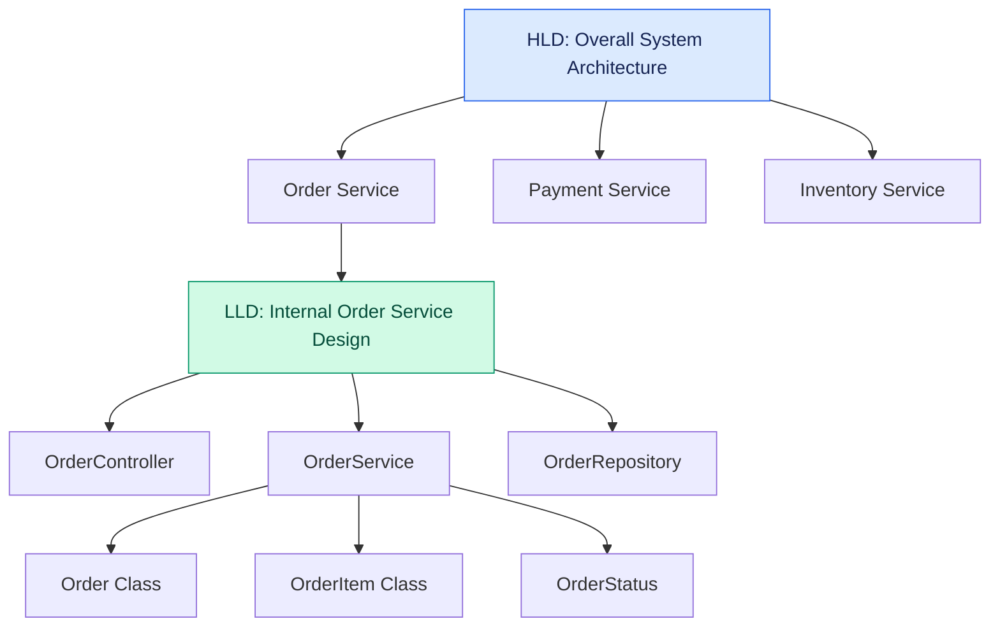

# Introduction to System Design

## Learning objectives

By the end of this lesson, you should understand:

1. What System Design is and why it matters.
2. The two levels of System Design: High-Level Design (HLD) and Low-Level Design (LLD).
3. How HLD and LLD differ.
4. How both levels work together when building real-world applications.
5. How to identify HLD and LLD decisions in a practical software project.

---

## 1. What is System Design?

Imagine you're asked to build an application like Amazon.

Your application must support millions of users who can:

- Register and log in.
- Browse products.
- Search for products.
- Add products to shopping carts.
- Place orders.
- Make payments.
- Track deliveries.
- Write product reviews.

Would you immediately start writing TypeScript classes and functions?

No.

First, you need to understand:

- What components the application needs.
- What responsibilities each component has.
- How different components communicate.
- Where data is stored.
- How the application handles increasing traffic.
- How the application behaves when something fails.

This entire planning process is called **System Design**.

### Definition

System Design is the process of defining the architecture, components, modules, interfaces, data flow, and interactions required to build a software system that satisfies specified functional and non-functional requirements.

In simpler words:

> System Design means planning how different parts of a software application work together to achieve a particular goal.

### Why do we need System Design?

Consider two approaches to building an e-commerce application.

**Without proper design:**



**With proper design:**



System Design helps achieve:

| Goal            | Explanation                                                                        |
| --------------- | ---------------------------------------------------------------------------------- |
| Maintainability | Modify functionality without unnecessarily affecting other components.             |
| Scalability     | Handle increasing users, traffic, and workloads.                                   |
| Reusability     | Reuse existing components instead of duplicating implementations.                  |
| Extensibility   | Introduce new features without redesigning everything.                             |
| Reliability     | Handle failures and continue operating correctly where possible.                   |
| Performance     | Make appropriate architectural and implementation decisions to improve efficiency. |

**Important:** Good design does not automatically guarantee scalability or reliability. It provides a structure in which those qualities can be achieved.

---

## 2. Two Parts of System Design: HLD and LLD

System Design is commonly divided into two levels:

1. **HLD — High-Level Design**
2. **LLD — Low-Level Design**

They solve different problems but complement each other.



## 2.1 High-Level Design (HLD)

### What is HLD?

High-Level Design focuses on the overall architecture of a software application.

It defines the major components of the system and explains how they communicate with each other.

HLD answers questions such as:

- What are the major components of the system?
- How do these components communicate?
- Which databases should we use?
- How will we handle millions of users?
- How will authentication work?
- How will we handle component failures?
- How will we distribute traffic?

### Example: Designing an E-commerce Application

Suppose we're building an application like Amazon.

At the HLD level, we identify the following components:

| Component            | Responsibility                           |
| -------------------- | ---------------------------------------- |
| Client Application   | Web and mobile interfaces                |
| API Gateway          | Routes incoming requests                 |
| User Service         | Manages users and authentication         |
| Product Service      | Manages product information              |
| Order Service        | Manages customer orders                  |
| Payment Service      | Processes payments                       |
| Inventory Service    | Manages product stock                    |
| Notification Service | Sends email, SMS, and push notifications |
| Database             | Stores persistent application data       |

### HLD Architecture Diagram



Notice something important:

We haven't discussed TypeScript classes, constructors, methods, or interfaces yet.

We're deciding:

- Which services are required.
- What responsibilities they have.
- How they communicate.
- What infrastructure they need.

That's HLD.

### Common HLD Concepts

| Concept                    | Purpose                                                         |
| -------------------------- | --------------------------------------------------------------- |
| Monolithic Architecture    | Organizes an application as one deployable unit.                |
| Microservices Architecture | Splits an application into independently deployable services.   |
| Load Balancing             | Distributes incoming traffic across multiple instances.         |
| API Gateway                | Provides a central entry point for API requests.                |
| Caching                    | Stores frequently accessed data for faster retrieval.           |
| Message Queues             | Enable asynchronous communication.                              |
| Database Replication       | Maintains copies of data across database nodes.                 |
| Database Sharding          | Distributes data across multiple database partitions.           |
| Horizontal Scaling         | Adds more machines or instances.                                |
| Vertical Scaling           | Increases the resources of an existing machine.                 |
| Fault Tolerance            | Allows a system to continue operating despite certain failures. |

These are architectural concepts that help us design large-scale systems.

---

## 2.2 Low-Level Design (LLD)

### What is LLD?

Low-Level Design focuses on the internal structure and implementation details of individual components.

It explains how a component should be implemented using classes, objects, interfaces, methods, and their relationships.

LLD answers questions such as:

- Which classes should we create?
- What responsibilities should each class have?
- Which attributes should a class contain?
- Which methods should it expose?
- How should objects communicate?
- Should we use an interface or an abstract class?
- How can we avoid tightly coupled code?
- How should we handle edge cases?

### Example: Designing the Order Service

Suppose HLD has already identified an Order Service.

Now we need to design its internal implementation.

We might identify these classes:

| Class              | Responsibility                      |
| ------------------ | ----------------------------------- |
| `Order`            | Represents an order and its state.  |
| `OrderItem`        | Represents an item inside an order. |
| `OrderService`     | Coordinates order operations.       |
| `PaymentService`   | Coordinates payment processing.     |
| `InventoryService` | Coordinates stock operations.       |
| `OrderRepository`  | Handles order persistence.          |

### LLD Class Diagram



Now we're thinking about object-oriented design.

### TypeScript Implementation

Let's implement a simplified version.

**Step 1: Define the Order Status**

```typescript
enum OrderStatus {
  CREATED = "CREATED",
  CONFIRMED = "CONFIRMED",
  CANCELLED = "CANCELLED",
}
```

**Step 2: Create the OrderItem Class**

```typescript
class OrderItem {
  constructor(
    public readonly productId: string,
    public readonly quantity: number,
    public readonly price: number,
  ) {
    if (quantity <= 0 || price < 0) {
      throw new Error("Invalid order item");
    }
  }

  getSubtotal(): number {
    return this.quantity * this.price;
  }
}
```

**Step 3: Create the Order Class**

```typescript
class Order {
  private status: OrderStatus = OrderStatus.CREATED;

  constructor(
    public readonly orderId: string,
    private readonly items: OrderItem[],
  ) {
    if (items.length === 0) {
      throw new Error("An order must contain items");
    }
  }

  calculateTotal(): number {
    return this.items.reduce((total, item) => total + item.getSubtotal(), 0);
  }

  cancel(): void {
    if (this.status !== OrderStatus.CREATED) {
      throw new Error("Only newly created orders can be cancelled");
    }

    this.status = OrderStatus.CANCELLED;
  }

  getStatus(): OrderStatus {
    return this.status;
  }
}
```

**Step 4: Use the Classes**

```typescript
const items = [
  new OrderItem("product-101", 2, 500),
  new OrderItem("product-102", 1, 1000),
];

const order = new Order("order-001", items);

console.log(order.calculateTotal());
// 2000

console.log(order.getStatus());
// CREATED

order.cancel();

console.log(order.getStatus());
// CANCELLED
```

This is an example of LLD because we're defining:

- Concrete classes.
- Attributes and properties.
- Constructors.
- Methods.
- Object behavior.
- Relationships between objects.

**Important engineering note:** This is a teaching example, not a production-ready order workflow. Real payment processing requires handling asynchronous failures, retries, idempotency, inventory reservations, and transaction consistency. Also, monetary values should generally use integer minor units or a suitable decimal representation rather than JavaScript floating-point arithmetic.

### Common LLD Concepts

| Concept          | Purpose                                                                   |
| ---------------- | ------------------------------------------------------------------------- |
| Encapsulation    | Protects an object's internal state.                                      |
| Abstraction      | Exposes essential behavior while hiding implementation details.           |
| Inheritance      | Allows a class to inherit behavior from another class.                    |
| Polymorphism     | Allows different implementations to be used through a common abstraction. |
| SOLID Principles | Helps create maintainable and extensible object-oriented designs.         |
| Interfaces       | Define contracts between components.                                      |
| Composition      | Builds complex objects using other objects.                               |
| UML Diagrams     | Visualize classes, relationships, and interactions.                       |
| Design Patterns  | Provide reusable approaches to recurring design problems.                 |

---

## 3. Difference Between HLD and LLD

Let's compare them directly.

| Aspect               | HLD                                    | LLD                                          |
| -------------------- | -------------------------------------- | -------------------------------------------- |
| Full form            | High-Level Design                      | Low-Level Design                             |
| Focus                | Overall architecture                   | Internal implementation                      |
| Perspective          | Big picture                            | Detailed picture                             |
| Main building blocks | Services, databases, APIs              | Classes, objects, methods                    |
| Main concern         | Component interactions                 | Object interactions                          |
| Database             | Database architecture and selection    | Entities, repositories, mappings             |
| Diagrams             | Architecture diagrams                  | Class and sequence diagrams                  |
| Scalability          | System-level scaling                   | Component-level efficiency and extensibility |
| Example              | Designing an Order Service             | Designing the `Order` class                  |
| Typical concepts     | Microservices, caching, load balancing | OOP, SOLID, design patterns                  |

### A Simple Real-World Analogy

Imagine constructing a house.

**HLD — House Blueprint**

It defines:

- Number of floors.
- Number of rooms.
- Kitchen and bathroom locations.
- Electrical and plumbing layout.
- Overall building structure.

**LLD — Construction Details**

It defines:

- Door dimensions.
- Window specifications.
- Wall materials.
- Electrical wiring details.
- Construction specifications.

You cannot effectively construct a house without understanding its overall layout.

Similarly, you shouldn't start implementing individual software components without understanding the system's requirements and architecture.

Both levels complement each other.

---

## 4. How HLD and LLD Work Together

Let's connect everything with a practical example.

Suppose a customer places an order in an e-commerce application.

### 4.1 HLD Perspective

At the architectural level, the workflow looks like this:



This describes communication between major components.

### 4.2 LLD Perspective

Inside the Order Service, we might have:



This describes how objects inside a component interact.

The exact implementation could differ from this simplified workflow, but it demonstrates the difference in abstraction.

### 4.3 Visualizing the Relationship



**Remember:**

- HLD defines major components and their interactions.
- LLD defines the internal structure and behavior of those components.

---

## 5. What Will We Focus on in This Learning Journey?

Our roadmap is primarily focused on Low-Level Design.

We'll learn how to:

1. Identify the right classes and objects.
2. Assign responsibilities to classes.
3. Establish relationships between objects.
4. Avoid tightly coupled code.
5. Apply SOLID principles.
6. Select appropriate design patterns.
7. Design extensible applications.
8. Translate requirements into TypeScript implementations.

We'll also discuss HLD concepts whenever they provide useful context for our practical projects.

---

## 6. Key Takeaways

| No. | Concept        | What to remember                                |
| --- | -------------- | ----------------------------------------------- |
| 1   | System Design  | Planning how software components work together. |
| 2   | HLD            | Defines overall system architecture.            |
| 3   | LLD            | Defines internal component implementation.      |
| 4   | HLD Components | Services, databases, APIs, infrastructure.      |
| 5   | LLD Components | Classes, objects, methods, interfaces.          |
| 6   | Relationship   | HLD and LLD complement each other.              |

### Important Terminology

- System Architecture
- Functional Requirements
- Non-Functional Requirements
- High-Level Design (HLD)
- Low-Level Design (LLD)
- Component
- Module
- Coupling
- Cohesion
- Scalability
- Extensibility
- Maintainability

---

## 7. Practical Exercise

Imagine you're building a food delivery application like Swiggy.

Your application has these major services:

1. User Service
2. Restaurant Service
3. Order Service
4. Payment Service
5. Delivery Service

Your task is to identify which decisions belong to HLD and which belong to LLD.

### Part A — HLD

- Identify the major services.
- Explain how they communicate.
- Identify where the application stores data.

### Part B — LLD

- Identify the classes needed inside the Order Service.
- Define their responsibilities.
- Identify their relationships.
- Suggest the methods required to place and cancel an order.

Try to think independently before implementing anything.

---

## 8. Interview-Oriented Questions

1. What is System Design, and why is it important?
2. What is the difference between HLD and LLD?
3. Can you give a real-world example of HLD and LLD?
4. What are functional and non-functional requirements?
5. Why should we design a system before implementing it?
6. Can a system have good HLD but poor LLD?
7. How do SOLID principles contribute to LLD?
8. What is the relationship between scalability and system architecture?
